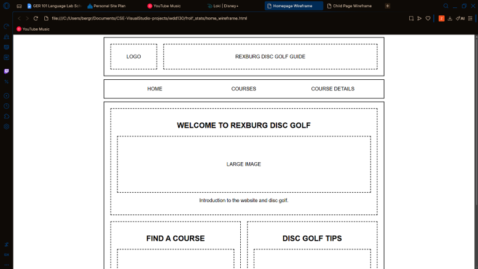
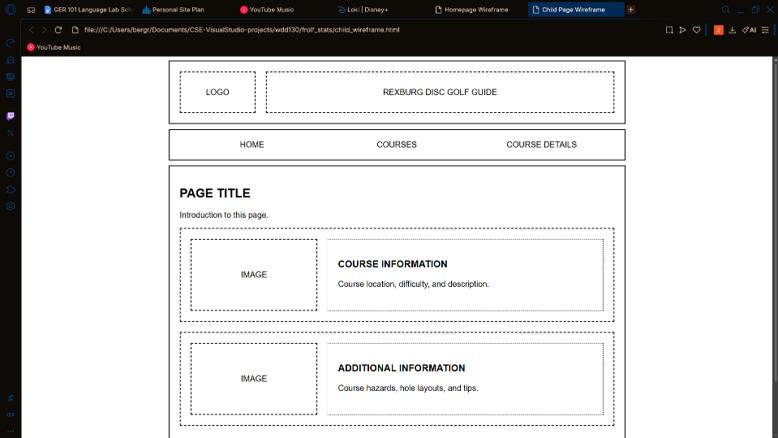

# WDD130 Project for: Zachary Duerksen - Course Facts

Github Pages [>>link<<](https://lifefountain855.github.io/wdd130-duerksen/)

## Purpose
To Give hazard details and overviews on Disk golf courses in Rexburg

## Audience
Disk Golf Players In the Rexburg Area

## Style Guide

### Color Palette
| Primary | Secondary | Accent 1 | Accent 2 |
|---|---|---|---|
| #234D32 | #A1BC8A | #F5F3EA | #292D2B |

### Typography
Heading Font: `Georgia`

Paragraph Font: `Times New Roman`

### Wireframes
home wireframe:

child wireframe:

---
*see full details in `./site-plan.docx`*